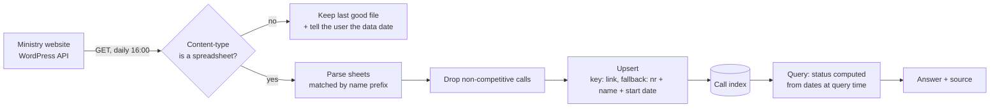

<div align="center">

# <PROJECT NAME>

**<One sentence: what it does and for whom.>**

[Quickstart](#quickstart) · [How it works](#how-it-works) · [Evaluation](#evaluation) · [Decisions](#architecture-decisions) · [What failed](#what-failed)

<!-- badges go here: Python version, license, CI status, eval score -->

</div>

---

> **24% of calls on the official "current" list had already closed.**
> Measured on 2026-09-21 on the national call list (n = 29). One day later it was 8 of 29.
> This system recomputes each call's status on every query instead of trusting the label.

<!-- ↑ Lead with a measured number. Replace or update it, but always keep the date and n. -->

## The problem

<Two or three sentences in the client's language, not the engineer's.
Who loses what, and when.>

## How it works



<!-- Floor 2 (regulations / RAG) will be added here once it exists. -->

## Quickstart

```bash
# <installation and run commands — fill in once the code exists>
```

## Evaluation

<!-- Fill in once the eval set exists. Keep one row per measured configuration. -->

| configuration | metric | result | n | date |
|---|---|---|---|---|
| <baseline> | | | | |

## Architecture decisions

Each decision has its own record in [`docs/adr/`](docs/adr/), with the alternatives
considered, the measurement behind it, and what it costs.

| ADR | decision | status |
|---|---|---|
| [0001](docs/adr/0001-fetch-via-wordpress-media-api.md) | Find files through the WordPress API; newest publication date wins | Accepted |
| [0002](docs/adr/0002-check-daily-at-1600.md) | Check once a day at 16:00 | Accepted |
| [0003](docs/adr/0003-validate-content-and-degrade-gracefully.md) | Validate content type; degrade gracefully | Accepted |
| [0004](docs/adr/0004-compute-status-at-query-time.md) | Compute status from dates at query time | Accepted |
| [0005](docs/adr/0005-upsert-never-delete.md) | Upsert, never delete | Accepted |
| [0006](docs/adr/0006-match-by-link-with-fallback-key.md) | Match by link, fall back to number + name + start date | Accepted |
| [0007](docs/adr/0007-exclude-non-competitive-calls.md) | Exclude non-competitive calls | Accepted |
| [0008](docs/adr/0008-three-valued-status.md) | Three-valued status; an imprecise end date is an interval | Accepted |
| [0009](docs/adr/0009-not-started-status-and-inclusive-end-date.md) | Fourth status "not started"; the end date is inclusive and the last day is announced | Accepted |
| [0010](docs/adr/0010-pin-generation-provider.md) | Pin one provider for the generation model; switch from Alibaba to StreamLake after `429`s | Proposed |

## What failed

<!-- Hypotheses that lost. This section is not a weakness — it is proof that choices were tested. -->

| hypothesis | prediction | result | what we learned |
|---|---|---|---|
| | | | |

## Data source & known limitations

- Source: monthly spreadsheets published by the Polish Ministry of Funds and Regional Policy.
- The WordPress API used to find new files is **not an official, guaranteed interface**.
- <Add further limitations as they are discovered.>
