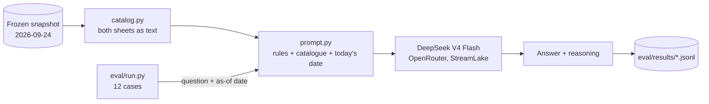
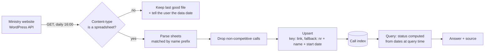

<div align="center">

# grant-finder-pl

**Answers business owners' questions about current Polish national funding calls, based on the ministry's spreadsheets.**

[Quickstart](#quickstart) · [How it works](#how-it-works) · [Evaluation](#evaluation) · [Decisions](#architecture-decisions) · [What failed](#what-failed)

</div>

---

> **24% of calls on the official "current" list had already closed.**
> Measured on 2026-09-21 on the national call list (n = 29). One day later it was 8 of 29.
> This system recomputes each call's status on every query instead of trusting the label.

> **Status: work in progress.** What runs today is hypothesis H0: the whole call catalogue
> goes into the prompt (CAG) and the model answers from a frozen snapshot of 2026-09-24.
> Fetching new files from the ministry website is designed (ADR 0001–0003, 0005–0006) but not built yet.

## The problem

A business owner, or the grant consultant or lawyer preparing their application, has to find
a call they can still apply to. The official list mixes dozens of calls from several national
programmes, its "current" label cannot be trusted (see the number above), and the eligibility
criteria are written in unclear official language. The cost is hours of searching and, at worst,
a lost chance at funding: an application prepared for a call that has already closed, or an open
call that nobody found in time.

This version tackles the first part: **which calls are open on a given day, and until when.**
Eligibility is out of scope for now.

## How it works

**What runs today (H0):**



**Target architecture (designed, not built yet):**



<!-- Floor 2 (regulations / RAG) will be added here once it exists. -->

## Quickstart

Requires Python 3.12+, [uv](https://docs.astral.sh/uv/) and an [OpenRouter](https://openrouter.ai/) API key.

```bash
uv sync
echo "OPENROUTER_API_KEY=sk-or-..." > .env

# one case first (smoke test), then all 12
uv run python -m eval.run --config reasoning-off --only D05
uv run python -m eval.run --config reasoning-off
```

Each run writes the raw answers to `eval/results/<date>_<time>_h0-cag_<config>.jsonl`.

## Evaluation

12 cases (3 representative, 8 diagnostic, 1 hard negative) in [`eval/cases.yaml`](eval/cases.yaml).
Each case is a frozen snapshot + an as-of date + a question + an expected answer, so results
do not change when the calendar does. Answers are graded by hand on a
[review card](eval/review/), and a prediction is written **before** every run in
[`eval/predictions.md`](eval/predictions.md).

| configuration | correct (eval set v1.1) | median latency | cost of 12 questions | n | date |
|---|---|---|---|---|---|
| H0 CAG, reasoning off | **8/12** | 5.3 s | $0.0038 | 12 | 2026-10-15 |
| H0 CAG, reasoning on | **10/12** | 27.1 s | $0.0055 | 12 | 2026-10-28 |

Model: `deepseek/deepseek-v4-flash`, provider pinned to StreamLake ([ADR-0010](docs/adr/0010-pin-generation-provider.md)).
Reasoning costs ~5× the latency for +2 cases: ×3.1 more output tokens, plus a slower provider on that run.

## Architecture decisions

Each decision has its own record in [`docs/adr/`](docs/adr/), with the alternatives
considered, the measurement behind it, and what it costs.

| ADR | decision | status |
|---|---|---|
| [0001](docs/adr/0001-fetch-via-wordpress-media-api.md) | Find files through the WordPress API; newest publication date wins | Accepted |
| [0002](docs/adr/0002-check-daily-at-1600.md) | Check once a day at 16:00 | Accepted |
| [0003](docs/adr/0003-validate-content-and-degrade-gracefully.md) | Validate content type; degrade gracefully | Accepted |
| [0004](docs/adr/0004-compute-status-at-query-time.md) | Compute status from dates at query time | Accepted |
| [0005](docs/adr/0005-upsert-never-delete.md) | Upsert, never delete | Accepted |
| [0006](docs/adr/0006-match-by-link-with-fallback-key.md) | Match by link, fall back to number + name + start date | Accepted |
| [0007](docs/adr/0007-exclude-non-competitive-calls.md) | Exclude non-competitive calls | Accepted |
| [0008](docs/adr/0008-three-valued-status.md) | Three-valued status; an imprecise end date is an interval | Accepted |
| [0009](docs/adr/0009-not-started-status-and-inclusive-end-date.md) | Fourth status "not started"; the end date is inclusive and the last day is announced | Accepted |
| [0010](docs/adr/0010-pin-generation-provider.md) | Pin one provider for the generation model; switch from Alibaba to StreamLake after `429`s | Proposed |

## What failed

Hypotheses that lost. Each one was written down before it was measured.

| hypothesis | prediction | result | what we learned |
|---|---|---|---|
| H0 without reasoning is almost enough | 11/12 (2026-09-25) | 8/12 | The model mis-compares dates in long lists (R01, R02, D04) even when the data is right. |
| Reasoning fixes the date comparisons | 11/12 (2026-10-28) | 10/12 | R01 and R02 fixed. D04 now double-counts the 7 calls listed in both sheets: the reasoning noticed the duplicates and counted them anyway. |
| Raw cell values are enough (decision 1A) | — | D10 fails in both runs | A date known only to the month reaches the model as an exact day. The data step must keep the display format. |
| One provider is as good as another (Alibaba) | stable | repeated `429` from a shared pool | Pin the provider and record why ([ADR-0010](docs/adr/0010-pin-generation-provider.md)). |

## Data source & known limitations

- Source: monthly spreadsheets published by the Polish Ministry of Funds and Regional Policy.
- The WordPress API used to find new files is **not an official, guaranteed interface**.
- Answers come from a frozen snapshot (2026-09-24); the live fetch is not built yet.
- 12 hand-written cases, graded by hand. n = 12 is small, and the questions are not from real users yet.
- With reasoning on, the median answer takes 27 s and the slowest 70 s: too slow for a plain HTTP request. Production would need streaming or a queue.
- Eligibility ("does my company qualify?") is out of scope: it needs a domain expert.
